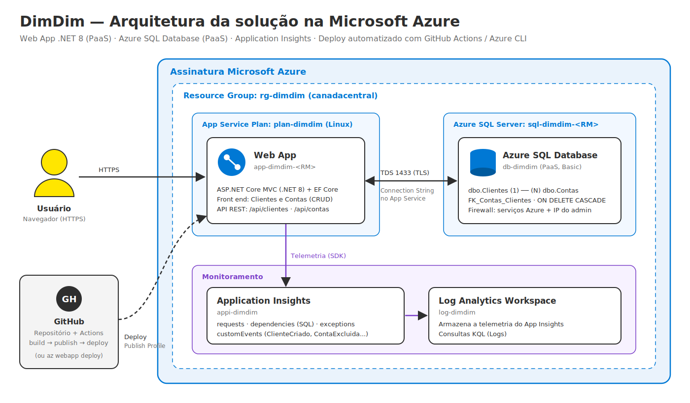

# DimDim – Web App + Azure SQL na Microsoft Azure

> 2º Checkpoint – 2º Semestre · DevOps Tools & Cloud Computing · Aplicações e Banco em Nuvem

| Integrante | RM |
|---|---|
| Nome Sobrenome | RM000000 |
| Nome Sobrenome | RM000000 |
| Nome Sobrenome | RM000000 |

**Vídeo com a solução funcionando:** https://youtu.be/SEU-LINK-AQUI

---

## 1. Descrição da solução

O **DimDim** é um banco digital fictício que contratou a consultoria do grupo para levar seu sistema de cadastro para a nuvem. A solução é uma aplicação web **ASP.NET Core MVC (.NET 8)** com **front end** próprio, onde o funcionário do banco:

- cadastra, consulta, edita e exclui **clientes**;
- abre, consulta, edita e encerra **contas** vinculadas a um cliente titular;
- acompanha no painel o saldo total sob custódia e as contas abertas recentemente.

Tudo roda em serviços **PaaS** da Azure:

| Componente | Serviço Azure | Função |
|---|---|---|
| Aplicação | Azure App Service (Web App Linux, .NET 8) | Hospeda o front end MVC e a API REST |
| Banco de dados | **Azure SQL Database** (PaaS, não containerizado) | Persiste as tabelas `Clientes` e `Contas` |
| Monitoramento | Application Insights + Log Analytics | Requisições, dependências SQL, exceções e eventos de negócio |
| Deploy | GitHub Actions (principal) ou `az webapp deploy` | Build e publicação automatizados |

**Persistência:** duas tabelas relacionadas (1:N) — `dbo.Clientes` e `dbo.Contas` — com chave estrangeira `FK_Contas_Clientes` (`ON DELETE CASCADE`). Há CRUD completo em **cada uma** das tabelas, tanto pelo front end quanto pela API.

**Segurança:** nenhuma credencial está no código. A connection string e a chave do Application Insights ficam nas configurações do App Service; a senha do banco é passada ao script via variável de ambiente ou digitada; o publish profile fica em um *secret* do GitHub.

## 2. Arquitetura



Fluxo: o usuário acessa o Web App por HTTPS → a aplicação (EF Core) lê e grava no Azure SQL Database pela porta 1433 com TLS → o SDK do Application Insights envia requisições, dependências SQL (com o texto do comando), logs e eventos customizados para o Application Insights, que armazena tudo no Log Analytics → o GitHub Actions compila e publica a aplicação no Web App a cada push na `main`.

## 3. Estrutura do repositório

```
.
├── .github/workflows/deploy.yml      # CI/CD: build + deploy no Azure Web App
├── api/operacoes.json                # JSON das operações GET, POST, PUT e DELETE
├── docs/arquitetura.png              # Desenho da arquitetura (e .svg editável)
├── scripts/
│   ├── ddl.sql                       # DDL das tabelas
│   ├── consultas-validacao.sql       # SELECTs para conferir cada operação no banco
│   ├── 01-criar-recursos.sh          # Azure CLI: cria todos os recursos
│   ├── 02-deploy-cli.sh              # Azure CLI: deploy alternativo (az webapp deploy)
│   └── 03-remover-recursos.sh        # Azure CLI: remove tudo
└── src/DimDim.Web/                   # Código fonte completo (.NET 8 MVC + EF Core)
    ├── Controllers/                  # Clientes, Contas, Home e Api/*
    ├── Data/DimDimContext.cs         # Mapeamento EF Core
    ├── Models/                       # Cliente, Conta, ...
    ├── Views/                        # Telas Razor (front end)
    └── wwwroot/css/site.css
```

## 4. Modelo de dados

```
dbo.Clientes                         dbo.Contas
-----------------------------        --------------------------------
Id            INT  PK IDENTITY  1 ─┐  Id            INT  PK IDENTITY
Nome          NVARCHAR(100)        │  Numero        NVARCHAR(20) UNIQUE
Cpf           CHAR(11) UNIQUE      │  Agencia       NVARCHAR(10)
Email         NVARCHAR(150)        │  Tipo          NVARCHAR(20) CHECK
Telefone      NVARCHAR(20) NULL    │  Saldo         DECIMAL(18,2) CHECK >= 0
DataCadastro  DATETIME2            │  DataAbertura  DATETIME2
                                   └N ClienteId     INT  FK -> Clientes.Id
```

DDL completo em [`scripts/ddl.sql`](scripts/ddl.sql).

---

## 5. How to – implantação completa na nuvem (passo a passo)

### 5.1 Pré-requisitos

- Assinatura Azure ativa (Azure for Students serve).
- Conta no GitHub.
- Usaremos o **Azure Cloud Shell (Bash)**, que já tem Azure CLI, .NET SDK, git, sqlcmd e GitHub CLI. Acesse em https://shell.azure.com.

> Para rodar na sua máquina: instale Azure CLI, .NET 8 SDK e sqlcmd, e faça `az login`.

### 5.2 Clonar o repositório no Cloud Shell

```bash
git clone https://github.com/<usuario>/<repositorio>.git
cd <repositorio>
```

### 5.3 Criar os recursos (Azure CLI)

Defina o RM (para os nomes serem únicos), a senha do banco e rode o script:

```bash
export RM=rm123456                          # RM do representante, só minúsculas e números
export SQL_ADMIN_PASSWORD='SenhaForte@2026' # mín. 8 caracteres com maiúscula, minúscula, número e símbolo
bash scripts/01-criar-recursos.sh
```

O script executa, em ordem:

1. Registra os providers `Microsoft.Web`, `Microsoft.Sql`, `Microsoft.Insights` e `Microsoft.OperationalInsights`.
2. Cria o resource group `rg-dimdim` na região `canadacentral`.
3. Cria o **Azure SQL Server** `sql-dimdim-<RM>` e o banco **`db-dimdim`** (tier Basic).
4. Libera o firewall para serviços da Azure e para o IP do Cloud Shell.
5. Executa o `scripts/ddl.sql` com `sqlcmd`, criando as tabelas.
6. Cria o Log Analytics `log-dimdim` e o **Application Insights** `appi-dimdim`.
7. Cria o App Service Plan Linux `plan-dimdim` e o **Web App** `app-dimdim-<RM>` (.NET 8, HTTPS obrigatório).
8. Grava no Web App a connection string `DimDimDb` e a `APPLICATIONINSIGHTS_CONNECTION_STRING`, e habilita o publish profile para o GitHub Actions.

> **Erro de região?** A Azure for Students restringe algumas regiões. O padrão é `canadacentral`; se falhar, rode de novo com outra: `export LOCATION=eastus2`.
>
> **sqlcmd falhou?** Abra o banco `db-dimdim` no portal → *Query editor* → entre com o usuário `dimdimadmin` e a senha → cole e execute o conteúdo de `scripts/ddl.sql`.

### 5.4 Configurar o deploy automatizado (GitHub Actions)

1. Gere o publish profile:
   ```bash
   az webapp deployment list-publishing-profiles -g rg-dimdim -n app-dimdim-$RM --xml
   ```
2. No GitHub, vá em **Settings → Secrets and variables → Actions**:
   - aba **Secrets** → *New repository secret* → nome `AZURE_WEBAPP_PUBLISH_PROFILE`, valor = XML inteiro do passo 1;
   - aba **Variables** → *New repository variable* → nome `AZURE_WEBAPP_NAME`, valor = `app-dimdim-<RM>`.

   (Se o GitHub CLI estiver autenticado, o próprio script oferece fazer isso.)
3. Dispare o pipeline: faça um push na `main` **ou** vá em **Actions → Build e Deploy - DimDim Web App → Run workflow**.
4. Acompanhe os jobs `build` e `deploy`. Ao final, o link do Web App aparece no job de deploy.

**Alternativa sem GitHub Actions** (Azure CLI + `az webapp deploy`):

```bash
bash scripts/02-deploy-cli.sh
```

### 5.5 Testar a aplicação (CRUD)

Acesse `https://app-dimdim-<RM>.azurewebsites.net` (o primeiro acesso no plano F1 pode levar alguns segundos).

| Operação | Clientes | Contas |
|---|---|---|
| Create | *Clientes → Cadastrar cliente* | *Contas → Abrir conta* (escolha o titular) |
| Read | Lista em *Clientes* e tela de detalhe | Lista em *Contas* e tela de detalhe |
| Update | *Editar* na linha do cliente | *Editar* na linha da conta |
| Delete | *Excluir* (remove também as contas do cliente) | *Encerrar* |

### 5.6 Conferir a persistência no banco

Portal → `db-dimdim` → **Query editor** → execute as consultas de [`scripts/consultas-validacao.sql`](scripts/consultas-validacao.sql) após **cada** operação, nas duas tabelas:

```sql
SELECT * FROM dbo.Clientes ORDER BY Id;
SELECT * FROM dbo.Contas   ORDER BY Id;
```

Ou pelo Cloud Shell:

```bash
sqlcmd -S tcp:sql-dimdim-$RM.database.windows.net,1433 -d db-dimdim \
  -U dimdimadmin -P "$SQL_ADMIN_PASSWORD" -i scripts/consultas-validacao.sql
```

### 5.7 Monitoramento com Application Insights

Portal → `appi-dimdim`:

- **Live Metrics:** requisições e chamadas ao banco em tempo real enquanto você usa o app.
- **Application map:** mostra o Web App chamando o Azure SQL (`db-dimdim`).
- **Performance → Dependencies:** tempo de cada comando SQL.
- **Failures:** exceções, se houver.
- **Logs** (KQL):

```kusto
// Requisições ao app
requests
| where timestamp > ago(1h)
| project timestamp, name, resultCode, duration
| order by timestamp desc

// Comandos executados no Azure SQL (monitoramento do banco)
dependencies
| where timestamp > ago(1h) and type == "SQL"
| project timestamp, target, data, duration, success
| order by timestamp desc

// Eventos de negócio do CRUD
customEvents
| where timestamp > ago(1h)
| project timestamp, name, customDimensions
| order by timestamp desc
```

> A telemetria pode levar de 1 a 3 minutos para aparecer em *Logs*. O *Live Metrics* é imediato.

### 5.8 Remover os recursos (após a correção)

```bash
bash scripts/03-remover-recursos.sh
```

---

## 6. API REST (complementar ao front end)

Além das telas, o app expõe endpoints REST. Exemplos completos de request/response em [`api/operacoes.json`](api/operacoes.json).

| Método | Rota | Descrição |
|---|---|---|
| GET | `/api/clientes` | Lista clientes |
| GET | `/api/clientes/{id}` | Cliente com suas contas |
| POST | `/api/clientes` | Cria cliente |
| PUT | `/api/clientes/{id}` | Atualiza cliente |
| DELETE | `/api/clientes/{id}` | Exclui cliente (e contas) |
| GET | `/api/contas` | Lista contas |
| GET | `/api/contas/{id}` | Conta com o titular |
| POST | `/api/contas` | Abre conta |
| PUT | `/api/contas/{id}` | Atualiza conta |
| DELETE | `/api/contas/{id}` | Encerra conta |

Exemplo com `curl`:

```bash
BASE=https://app-dimdim-$RM.azurewebsites.net
curl -X POST $BASE/api/clientes -H "Content-Type: application/json" \
  -d '{"nome":"Ana Souza","cpf":"12345678901","email":"ana@dimdim.com","telefone":"11999990000"}'
curl -X POST $BASE/api/contas -H "Content-Type: application/json" \
  -d '{"numero":"48213-7","agencia":"0001","tipo":"Corrente","saldo":1500,"clienteId":1}'
curl $BASE/api/clientes/1
```

## 7. Rodar localmente (opcional)

```bash
cd src/DimDim.Web
dotnet user-secrets init
dotnet user-secrets set "ConnectionStrings:DimDimDb" "<sua connection string>"
dotnet run
```

## 8. Tecnologias

.NET 8 · ASP.NET Core MVC · Entity Framework Core 8 (SQL Server) · Azure App Service (Linux) · Azure SQL Database · Application Insights · Log Analytics · Azure CLI · GitHub Actions
